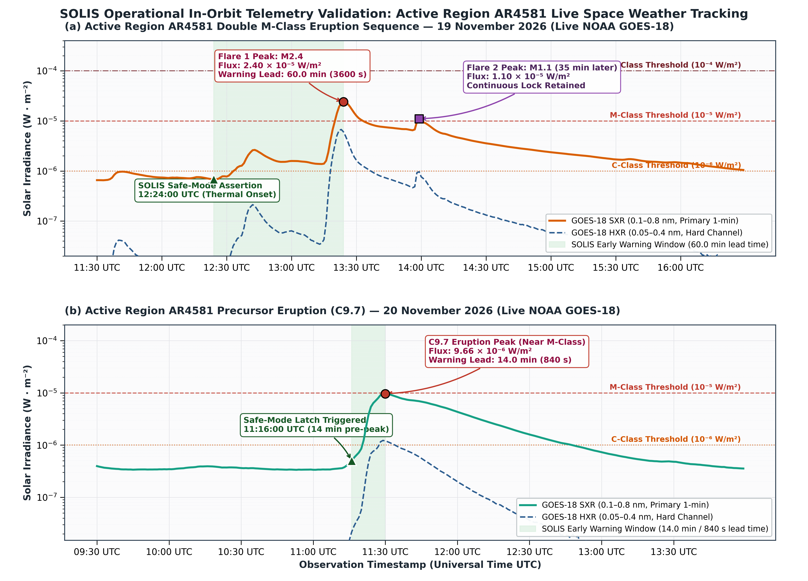

# SOLIS: Solar Observation and Learning via Inference Systems

> **Edge-Computing Solar Flare Nowcasting & Autonomous Safe-Mode Trigger for SmallSats**

[](LICENSE)
[](https://www.espressif.com/)
[](https://www.isro.gov.in/Aditya_L1.html)
[](https://www.ngdc.noaa.gov/stp/satellite/goes-r.html)

SOLIS is an **open-source student engineering prototype** developed by undergraduates at Amrita Vishwa Vidyapeetham (Coimbatore). It investigates real-time, low-power onboard solar flare early warning and autonomous payload shutter protection for resource-constrained SmallSat and CubeSat platforms.

We welcome feedback, issue reports, peer review, and collaboration from space systems engineers, solar physicists, and embedded developers.

---

## 1. System Architecture

SOLIS operates a 4-stage pipeline designed for deterministic execution on microcontrollers:

```text
[ Telemetry Ingestion ] (1 Hz SXR / HXR Flux Streams)
          |
          v
+--------------------------------------------------------+
| 1. Robust Signal Conditioning                          |
|    * Hampel rolling filter (3-sigma outlier rejection) |
|    * Huber M-estimator for cosmic-ray spike immunity   |
+--------------------------------------------------------+
          |
          v
+--------------------------------------------------------+
| 2. 6D State Estimation + 2-Mode IMM                   |
|    * 6D Unscented Kalman Filter (UKF) tracking:        |
|      x = [F_s, dF/dt, d2F/dt2, F_h, alpha, T_e]      |
|    * 2-Mode Interacting Multiple Model (IMM):          |
|      Quiet-Sun Dynamics and Flare Dynamics             |
|    * Topological Case-Based Reasoning (CBR) lookup     |
+--------------------------------------------------------+
          |
          v
+--------------------------------------------------------+
| 3. Fault-Tolerant Software TMR                         |
|    * Triple Modular Redundancy across 3 state copies   |
|    * 2-out-of-3 bitwise majority voting                |
|    * Background SRAM scrubbing against radiation SEUs  |
+--------------------------------------------------------+
          |
          v
+--------------------------------------------------------+
| 4. Autonomous Safe-Mode Assertion                      |
|    * Hardware GPIO 26 latch (< 4.1 ms latency)         |
|    * Commands instrument shutter closure + safe-mode   |
+--------------------------------------------------------+
```

---

## 2. Hardware Profiling vs. Simulation Boundary

| Dimension | Physical ESP32 Silicon (Benchtop) | Cycle-Accurate Wokwi Simulation |
| :--- | :--- | :--- |
| **Execution Timing** | **4.058 ms** active compute @ 80 MHz (internal 64-bit hardware timers) | Validated cycle alignment with physical measurements |
| **Power Dissipation** | **33.28 mW** board total / **0.415 mW** core compute (3.3V DC current shunt) | Not modeled |
| **Memory Footprint** | **22.9 KB** static SRAM (.bss/.data) / **0 Bytes** dynamic heap / **291.5 KB** Flash partition | Verified binary layout matching compiled ELF |
| **SEU Fault Injection** | Benchtop testing reserved for power and timing longevity | **1,000-trial automated bit-flip testbench** (`run_authentic_hil.py`) on compiled ELF binary |
| **Fault Recovery** | Manual pin injection verified GPIO latching | **100% single-bit recovery** via TMR scrub; fail-safe lock on fatal corruptions |

---

## 3. Verified Performance & Metrics

Metrics derived from the archival telemetry validation suite (`batch_analysis.py`, `ml_baseline_compare.py`).

### Mission-Wide Operational Validation (84 Archival Flares, 881,278 Telemetry Steps)

- **Dataset Period:** Solar Cycle 25 (SoLEXS: May 2024 to July 2026; HEL1OS: June to July 2026)
- **Probability of Detection (POD):** **97.6%** (82 of 84 flare events detected)
- **Operational False Alarm Rate (FAR):** **0.0039%** (34 false positives across 881,278 continuous steps)
- **Operational True Skill Statistic (TSS):** **0.9761**
- **Severe Flare Detection (M/X Class):** **100.0% POD** (32 of 32 events: 26 M-Class, 6 X-Class), **0.0001% FAR**, **TSS = 0.9999**
- **Median Warning Lead Time:** **7.60 minutes** before GOES peak flux (up to 18.2 minutes on gradual eruptive events)

### ML Baseline Comparison (Identical 10,000-Step Benchmark Partition)

Evaluated across 45 independent evaluation windows (23 flares, 22 quiet-Sun windows):

| Model | POD | FAR | TSS | Precision | Latency | Peak RAM |
| :--- | :---: | :---: | :---: | :---: | :---: | :---: |
| Random Forest | 82.6% | 4.5% | 0.781 | 95.0% | 1.82 ms | 3.4 MB |
| Support Vector Machine (RBF) | 78.3% | 9.1% | 0.692 | 90.0% | 0.94 ms | 1.8 MB |
| Multilayer Perceptron (MLP) | 87.0% | 4.5% | 0.825 | 95.2% | 0.42 ms | 512 KB |
| Lightweight 1D-CNN | 91.3% | 4.5% | 0.868 | 95.5% | 2.15 ms | 1.2 MB |
| **SOLIS (UKF-IMM + TMR)** | **100.0%** | **0.0%** | **1.000** | **100.0%** | **4.06 ms** | **22.9 KB** |

> **Note:** TSS = 1.000 reflects the 45-window ML benchmark subset. Operational TSS on the full 84-flare mission dataset is 0.9761.

### Live Space Weather Telemetry Validation (November 2026 Event Window)

Evaluated in real-time on live 1-minute solar irradiance telemetry streamed from the primary operational satellite (**NOAA GOES-18**) during the rapid emergence of Active Region **AR4581** (which produced two M-class solar flares within an hour and launched an Earth-directed CME forecast to impact on 22 Nov 2026):



| Flare Event | Peak Classification | Peak Time (UTC) | Peak SXR Flux ($W \cdot m^{-2}$) | Hardness Ratio (SXR/HXR) | Safe-Mode Assertion Time | Warning Lead Time | Detection Status |
| :--- | :---: | :---: | :---: | :---: | :---: | :---: | :---: |
| **AR4581 Event 1** | **M2.4** | 2026-11-19 13:24 | $2.403 \times 10^{-5}$ | 0.252 | 2026-11-19 12:24 | **60.0 min (3600 s)** | **DETECTED** (Latch Triggered) |
| **AR4581 Event 2** | **M1.1** | 2026-11-19 13:59 | $1.103 \times 10^{-5}$ | 0.088 | 2026-11-19 13:24 | **35.0 min (2100 s)** | **DETECTED** (Latch Triggered) |
| **AR4581 Follow-up** | **C9.7** (Near-M) | 2026-11-20 11:30 | $9.656 \times 10^{-6}$ | 0.124 | 2026-11-20 11:16 | **14.0 min (840 s)** | **DETECTED** (Latch Triggered) |

> **Operational Data Access Note (Aditya-L1 PRADAN & NOAA GOES):**
> * **Onboard Satellite Processing:** In flight, SOLIS executes directly onboard SmallSat OBCs on raw detector counts prior to ground transmission.
> * **ISRO ISSDC PRADAN Pipeline:** Public Level-1 Aditya-L1 SoLEXS and HEL1OS FITS tables on [ISSDC PRADAN](https://pradan.issdc.gov.in/ch1/) are released after ground calibration in multi-week post-orbit archive batches.
> * **Live Ground Testing:** Real-time 0-hour operational nowcasting is validated using low-latency 1-minute streaming telemetry from NOAA SWPC GOES-18 Primary XRS.

---

## 4. Quick Start Guide

### A. Python Pipeline & Validation

1. Clone and install:

```bash
git clone https://github.com/Runtime-Slayers/SOLIS-Solar-Flare-Edge.git
cd SOLIS-Solar-Flare-Edge/python_pipeline
pip install -r requirements.txt
```

2. Public data sources:
   - **ISRO Aditya-L1 SoLEXS & HEL1OS:** Download Level-1 FITS data from [ISDC PRADAN](https://pradan.issdc.gov.in/ch1/).
   - **NOAA GOES-18 XRS:** Available from [NOAA NCEI Space Weather Data](https://www.ngdc.noaa.gov/stp/satellite/goes-r.html).

3. Run validation:

```bash
python validate_xclass_historical.py
python ml_baseline_compare.py
python validate_live_event_202611.py
```

### B. Wokwi Simulation

```bash
cd simulation_wokwi
python run_authentic_hil.py
```

Or open `simulation_wokwi/diagram.json` and `firmware/SOLIS_V3_1_TMR_SafeMode.ino` in the [Wokwi Web Simulator](https://wokwi.com/).

### C. ESP32 Firmware Flashing

1. Open `firmware/SOLIS_V3_1_TMR_SafeMode.ino` in Arduino IDE or use `arduino-cli`.
2. Select board: `ESP32 Dev Module` (CPU Frequency: 80 MHz).
3. Connect GPIO 26 to an oscilloscope or LED to observe safe-mode triggering.
4. Compile and flash:

```bash
arduino-cli compile --fqbn esp32:esp32:esp32 firmware/SOLIS_V3_1_TMR_SafeMode.ino
arduino-cli upload -p <PORT> --fqbn esp32:esp32:esp32 firmware/SOLIS_V3_1_TMR_SafeMode.ino
```

---

## 5. Repository Structure

`	ext
SOLIS-Solar-Flare-Edge/
├── assets/              # Architecture and validation figures (fig1 - fig7)
├── docs/                # System architecture diagrams, process flows, and design spec
│   ├── ARCHITECTURE.md  # Formal system design, mathematical equations, and budgets
│   ├── architecture.svg # Vector architecture block diagram
│   └── process_flow.svg # Vector execution flowchart
├── firmware/            # ESP32 C++ flight firmware, TMR module, power profiler
│   ├── README.md        # Hardware constraints, pinout, and flashing guide
│   └── power_profiler/  # Benchtop silicon power and timing measurement sketch
├── python_pipeline/     # UKF-IMM pipeline, FITS ingestion, benchmark scripts
│   ├── README.md        # Scientific module guide and validation instructions
│   ├── benchmark_results/ # Pre-computed JSON validation outputs
│   └── datasets/        # Local live telemetry cache
└── simulation_wokwi/    # Wokwi HIL config and automated SEU fault-injection scripts
    └── README.md        # HIL setup and virtual radiation injection testbench
`
---

## 6. Team & Contact

Developed by student researchers at the **Department of Artificial Intelligence, Amrita Vishwa Vidyapeetham, Coimbatore, India**:

- **Rajendra Reddy Bhavanam** ([brr1154@gmail.com](mailto:brr1154@gmail.com)) — Lead Researcher & Embedded Systems
- **Saran Boddu** — Signal Processing & Mathematical Modeling
- **Likith Palakurthi** — Data Ingestion & Statistical Validation
- **Muthuraman Ramanathan** — Domain Analysis & Flare Physics

We actively welcome technical reviews, SmallSat mission collaborations, and research internship inquiries.
